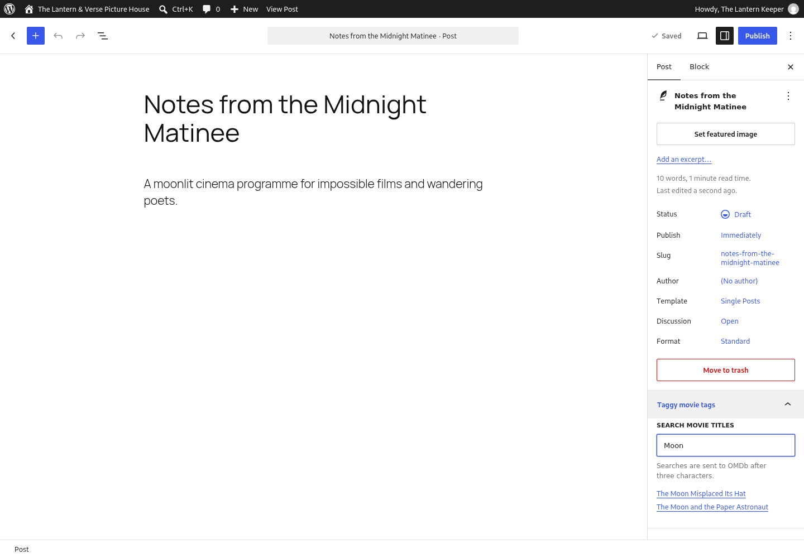

<!-- ACE_SUITE_BRAND:START -->

  

  <a href="https://acemedia.ninja/">Ace Media</a> · <a href="https://acemedia.host/">WordPress hosting</a>

<!-- ACE_SUITE_BRAND:END -->

# Taggy

I built Taggy to make movie tags easier to add to WordPress posts. It searches OMDb from a small panel in the block editor and lets you add a title as a normal WordPress tag.

Install the release ZIP, add your own OMDb API key in **Settings → Taggy**, then open a post and use **Taggy movie tags**. Select a title and save the post. WordPress 6.0 and PHP 7.4 or later are required.

The key stays on your server. Search text goes to OMDb when you search; see [service disclosure](readme.txt). Each multisite site keeps its own settings. This release supports the block editor, not a Classic Editor interface.

## Developers

The JavaScript uses WordPress's own editor packages and requires no separate build. Run `python3 scripts/package.py` to create the runtime ZIP. On a disposable WordPress installation, `wp eval-file tests/search.php` checks permissions, malformed input, response safety and caching with a stubbed service response. See [developer notes](docs/wiki/Developer-guide.md), [release validation](docs/release-validation.md), [contribution guidance](CONTRIBUTING.md) and [security reporting](SECURITY.md).

Public [issues](https://github.com/AceMedia/Taggy/issues) are welcome. Please discuss contributions before submitting a pull request; Ace Media maintains official releases. The GPL licence remains unchanged.

[More Ace projects](https://acemedia.ninja/) · [Ace Media hosting](https://acemedia.host/)

## Demo

This screenshot uses a local stub with fictional titles; it is not a live OMDb search.
